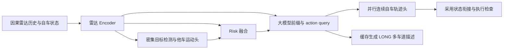

# RadarVLA 瓶颈修复与下一代动作接口

基线：`959e69aba30878d8e09954b555fe1c916843a9d1`。实现分支：
`codex/bottleneck-fixes-20261023`。本轮已实现协议、执行衔接、生成缓存、规划调度修复，以及 opt-in 检测分配、
Risk 物理融合和连续动作头；已完成合成数据与本地小型 Qwen 回归，尚未进行真实数据重训。
单车道、多车道及已有 C0/A/B 配置继续作为独立对照。

## 1. 结论与证据

不把下一轮投入放在扩大骨干、同时调多项 loss 或直接启动响应 RL。
优先消除确定的执行障碍，再把“生成驾驶动作”和“生成长篇结构化描述”拆开。
大模型仍决定自车动作；连续动作头读取大模型的决策特征，而非绕过大模型。

| 证据 | 对修改的约束 |
| --- | --- |
| 最新同一 1451 帧、epoch 20，0.5/1/2 s 危险正例只有 13/15/22 帧；阈值 .5 时 C0 找回 0/0/1，A 为 0/0/3，B 为 0/0/9 | 当前分数不能直接按 .5 解释成可靠危险判定；但降低阈值也不能消除排序错误 |
| 0.5 s 召回至少 80% 所需最少误报帧：C0 35，A 105，B 192；1 s 为 10/29/61 | B 的部分指标上涨不是统一改进，不能直接选 B 替代 C0 |
| 同一 1213 个共同检出 GT 的他车 future ADE：C0 2.09193 m，A 2.11080 m，B 2.22730 m | 风险改动不能以损害运动预测为代价；必须比较共同 GT |
| 三组的全部 22 个 2 s 危险样本均预测 dmin > .5 m，实际均 < .5 m | 仅做概率校准不够，需要改善危险几何的表征 |
| 历史 SFT 同一 8464 个要求点，free / teacher-forced numeric / codec / CV ADE = 1.1293 / .3527 / .1699 / .9223 m | 自回归数值动作有明显误差；单纯增加量化 bins 不足以解释或修复差距 |
| B 与 C0 的实际 epoch 1、20 样本顺序不同；集合相同 | 不能把 B 的全部变化归因于 brake 权重；下一轮固定实际初始权重和样本顺序 |

这些是归档复算，不是本轮新增训练成绩。阈值结果是同一 val 上的探索上界，
不可作为独立测试或部署阈值。短窗正例集中在极少 episode，邻帧不是独立危险事件。
历史 SFT 与最新 KRS-v2 Grounder 也不是同一个训练阶段，不能合成一条端到端成绩。

复算程序读取固定提交内的原始归档，校验共同样本和有效分母，输出各输入 blob 的 SHA256：

```bash
.conda/bin/python scripts/audit_bottleneck_evidence.py \
  --output artifacts/bottleneck_fixes_20261023/evidence.json
```

## 2. 本轮落地的修复

### 2.1 保留输入版本协议

`response_rl._observation` 保留 Dataset 提供的 `risk_horizon_schema_id` 和
`detection_class_schema_id`。它们属于输入契约；GT future、GT Risk、agents 和地图
标签仍不进入规划观察。新协议能够执行，错误协议仍被拒绝，旧协议保持兼容。

### 2.2 在真实采用状态上连接轨迹

旧自然三次样条强制起点加速度为零，而转弯 CV/CTRV 基线的加速度为 `|v·yaw_rate|`。
严格的加速度连续性检查因而可能拒绝所有控制点选择。这不是加大容忍值能解决的问题。

新增 `reward.adoption_transition_s`，默认 `0` 保持旧协议。实验配置取固定 `τ=.5 s`：

1. 在计划可采用时刻，从当前执行轨迹取得位置、速度、加速度和朝向。
2. 用五次多项式连接该状态与新轨迹在本地 `τ` 时刻的 p/v/a。
3. `τ` 以后仍使用原轨迹；原生时域不延长，SHORT 末端仍用原有受限停车延续。
4. 对桥接段的加速度、jerk 向量范数求内部极值，超限或 `τ` 超出原生时域则拒绝。
5. 响应计时、奖励、连续重规划、导出使用同一条连接后的轨迹。
   导出保留原始跳变、桥接系数和失败原因；拒绝的桥接不能作为已采用动作计时。

这是兼容旧 token/checkpoint 的执行适配层，并非车辆动力学或碰撞安全证明。
它能修复可行的小幅衔接，不能把任意坏动作修成可执行动作。固定 `τ` 是需要验证的
实验参数；响应起点仍按实际持续变化测量，不直接记为 `0` 或 `τ`。
桥接构造/检查的 CPU 开销尚未包含在 `measure_plan.generation_s` 中，部署计时需补齐。

### 2.3 生成缓存

新增 HF 选项 `language_model.generation_use_cache: true`，默认关闭。
首步 prefill 连续雷达/自车/Risk 条件、指令和 BOS；以后只前向一个新 physical token。
RoPE 的位置按有效 token 计数，KV 槽位包含 padding；每个观察独立缓存。
greedy、RL 采样和固定动作计时重放共用此路径；训练/概率重评分保留完整序列。
参数和 checkpoint 格式未变，但训练恢复仍检查完整配置，不能把改配置当原实验续训。

真实随机小型 Qwen 的 FP32/BF16、LoRA 梯度及缓存隔离可在 CPU 回归验证；
目标 Qwen2.5-3B 的 GPU 时延、显存和长序列数值差异必须另测，不能从单测推导加速倍数。

### 2.4 规划队列

新增 `planner_observation_policy`：默认 `fifo`；实验取 `latest_ready`。
每次空闲时只处理当前已经就绪的最新观察，丢弃尚未开始的更旧观察；没有已就绪观察时
等待下一帧。不取消已开始的生成，不读取未来帧，不重置首次检测时钟。
RL 重评分必须用实际被选择的帧，不能把跳帧后的动作和原始帧序列直接 zip。
报告选中帧、跳帧数、开工时刻、observation age，区分“更快生成”和“减少过期输入”。

本开关只作用于响应 RL 的事件重放。感知预处理目前仍按 FIFO 计时，普通
`predict` 仍是逐样本批量评估；尚未实现传感器到控制器的实时调度服务。

## 3. 确定的目标架构



图中 Risk 物理融合、action query 和并行轨迹头已实现，默认旧配置保持旧模型结构。
8×L40S 的配置与固定初始化链见 [服务器实验手册](BOTTLENECK_8XL40S_RUNBOOK.md)。
道路感知仍保留已有单/多车道对照，不把本次动作接口试验混入道路结构消融。

### 3.1 他车检测：先改分配，不盲目换骨干

保留 C0 雷达骨干、两槽位密集检测和现有运动头。第一项检测实验仅将固定 anchor
中心的 Hungarian 分配改为**局部一对一质量分配**：局部候选仍由 anchor 几何定义，
匹配代价使用 detach 的预测中心误差与框重叠质量；不按置信度提前删掉候选。
每个 GT 一次监督，防止多正例同时改变运动 loss 权重。

首版实现固定：训练原分配预热前 2 个 epoch，验证始终使用配置分配；之后代价为
`||pred_xy-gt_xy|| / 2m + (1-IoU)`，候选限制在最近 anchor 的 3×3 网格邻域，并与合法候选 mask 取交集。
局部无法完成一对一分配时，整帧回退到全局 anchor-distance 匹配，并按 rank 记录帧/目标数。
新策略排序仅使用已知当前字段及稳定 agent_id；未知标签占位不影响分配，不使用 GT future。
旧 anchor_v1 保留原排序；新策略回退沿用新排序，因此完全重合目标的 tie 不保证等于旧结果。
这些是预先登记的实验起点，不是已验证最佳超参数。若尝试多正例，另开分支并按 GT
归一化运动监督，不能混入本项对照。

先重放最新连续漏检事件，保存阈值前全部候选、GT 分配索引、框、分数、回波、速度。
如果失误主要来自低信号/定位，则否定“分配优先”的假设，转向因果历史关联；
不能拿旧协议的低 objectness 诊断冒充新 checkpoint 的逐帧原因。

检测数由候选筛选与 NMS 决定，不加 8 个目标上限。当前 `max_agents=8` 是描述长度
限制，不是密集检测或 Risk 的目标数。最终要覆盖车辆、行人、自行车及静止障碍时，
必须另立 all-road-users 数据协议：目标存在性与语义类别为标签，运动/静止为属性。
当前 moving-v1 将静止车辆、行人、自行车作为背景，不能继续拿它验证全类别目标。
当前 `agent_v1` 也没有语义分类头。全类别版本需恢复现有四类分类接口（vehicle /
pedestrian / cyclist / other）并建立匹配的数据与 Risk 契约；未知类别保留显式 mask。
它应单独训练与验收，不把单类 checkpoint 隐式加载为多类模型。

### 3.2 Risk：保留雷达路径，加入预测物理关系

输入原始雷达 tokens、自车状态、**阈值前全部合法密集候选**的预测位置、尺寸、朝向、
速度、未来轨迹和 objectness。候选经过共享 MLP；Risk query 对它们注意力聚合，
再与原雷达特征融合。按当前约 1458 个候选、一个 Risk query 的量级做首版，
不先做硬 top-8 或 score>.5 裁剪，不用 GT 匹配选择输入目标。

补充自车与预测目标的相对运动，以及自车中心点到预测目标有向框的采样间距。
这不是两车车身间距，未来框沿用预测当前 heading。预测物理量 detach，融合 MLP 可训练，
原雷达路径保留梯度。第一轮冻结非 Risk 的 Grounder 参数，
只训练 Risk query/attention/head 和新融合模块，检验 .5/1 s 风险尾部是否能读出；无收益就停止解冻扩训。
保留雷达路径，因为检出集合漏掉危险对象时，原 Risk 仍可能提供有效信息。

概率头与决策阈值分开：独立比较维持真实采样先验的 BCE 概率头和现有 focal 分数，
不能一边过采样正例一边声称未经修正的概率已校准。阈值用独立 episode 的校准集确定，
固定误报预算后冻结。dmin、正 areq 和无解/未知 mask 继续独立评估，不能只看 AP。

### 3.3 自车动作：一个大模型 action query，连续并行输出

首版选定 `parallel_acceleration_v1`，新增协议，不替换旧数值 token checkpoint：

- action query 放在全部可观测条件之后；一次大模型 prefill 的 query 隐状态
  同时输入模式头与连续动作头。模式标签不充当生成动作的 GT 前缀。
- 动作头同时预测未来 6 个 `.5 s` 间隔的二维加速度残差，LONG 为 3 s，SHORT
  使用前 1 s 并显式接停车延续。LONG 的道路/目标描述之后生成，不阻塞动作输出。
- 初始 p/v/a 来自当前状态估计，不能用未来 GT 作为输入；加速度缺测时明确标记
  CV/CTRV 估计。生成期间状态变化仍由采用适配器处理。
- SFT 与部署的 action query 接收雷达 tokens、预测 Risk、可观测自车状态和用户指令；
  预测目标物理信息由新 Risk 分支融合。GT 世界描述和未来轨迹只用于监督，
  action query 不接收 teacher token 前缀。新动作配置拒绝 Oracle Risk 和 GT Risk 混合。
- 残差相对可观测 CV/CTRV 基线预测，避免把驻车也强迫从零学习远处坐标。
  低速停驻与正常起步都参与监督，不能在线按真实未来选择停/走。

每段对总加速度而非单独残差或单独 XY 分量施加约束：
`a*=Proj_A(a_base+δa)`，
`a[k+1]=a[k]+min(1,Jmax·Δt/||a*-a[k]||)·(a*-a[k])`，零差值时直接保持。
这同时限制 `||a*||≤Amax` 和 `||a[k+1]-a[k]||≤Jmax·Δt`。
若实际初态已经超限，显式返回不可行，不能瞬间裁剪初始加速度。
以 `j=(a[k+1]-a[k])/Δt` 精确积分：

```text
p[k+1] = p[k] + v[k]·Δt + .5·a[k]·Δt² + j·Δt³/6
v[k+1] = v[k] + a[k]·Δt + .5·j·Δt²
```

该表示保证 p/v/a 连续；初态在界内时可限制加速度和 jerk。它仍不是完整车辆模型，
需另查非完整约束、曲率、倒车及路界，不能声称限制 XY 加速度就保证可驾驶。
SHORT 接停车之前必须先过渡到与停车延续兼容的终端加速度；不能直接复用旧接口
“自然样条终端加速度为零”的假设。新 decoder、训练损失、执行器必须共同版本化。
该终端过渡属于执行续接，可延长 execution horizon，不能延长 native 或 GT horizon；
仍需连续积分并检验加速度/jerk，无解则拒绝。响应起点从包含过渡的实际轨迹计算，
不能因声明“接停车”就直接给予响应奖励。

本轮服务器 SFT 冻结 Grounder，训练 action head/query、自车与雷达/Risk adapters，
并启用与旧 token 对照相同的 LoRA 设置。损失为有效 GT 位置 SmoothL1、独立模式 CE，
加权描述 CE（默认 .1）；初态与 A/J 约束由积分和投影结构实现。
未用稀疏位置差分冒充瞬时速度标注，也未新增道路/碰撞 loss。描述损失在验证报告中单列。
动作头取消自车动作对 64-bin 自回归数字序列的依赖。6 段动力学投影/积分使用 float64
减少边界舍入造成的假超限，Transformer/MLP 仍按配置精度运行。

`predict` 默认只产生新动作；`--include-description` 在该批所有动作就绪后生成独立
`description`，其 ego 数值字段不参与描述监督或执行，描述耗时单独报告。描述模式可与
动作模式不同，不能用描述覆盖动作。同步 CLI 会等全部结果写出，并非实时异步发布服务。

现有离散 token RL 不支持连续动作的策略密度，新动作 checkpoint 会被明确拒绝；
本轮不伪造连续动作 log-prob，也不宣称 E4 已实现。旧 token RL 继续可用。

## 4. 实验次序与停止条件

| 阶段 | 固定项与唯一主要变化 | 必须报告 / 继续条件 |
| --- | --- | --- |
| E0 工程对照 | 同 checkpoint 同动作；分别开 cache、桥接、latest_ready | 输出/重评分一致性、桥接拒绝率、P50/P95 动作可采用时延、age/跳帧、显存；不能只报 token 数 |
| E1 检测分配 | C0 数据/骨干/初始化/batch 顺序/损失固定，只改 assignment | 固定 FP 预算危险目标召回、首次检出、连续漏检时长、共同 GT 运动 ADE；不得靠大量误报获胜 |
| E2 风险读出 | 冻结同一感知；分别试物理融合和概率损失 | .5/1/2 s 的事件召回/FP、dmin 危险尾部、正 areq；没有改善就不扩大训练 |
| E3 连续动作 | 同感知与 episode；旧 token 动作对比新 action query | 同点 ADE、停驻/起步分层、执行有效率、误响应、首次持续变更、已知碰撞；语法正确不代表动作正确 |
| E4 响应 RL（连续策略待实现） | 先有可用 E3 SFT，并实现连续策略及概率重评分；相同危险/无害事件与运行负载 | 相对 SFT 的有效响应更快，漏响应/误响应/已知碰撞不恶化；保留第 0 轮基线 |

先修实际 worker 的复现记录：归档 worker 源码、初始权重 hash、每 epoch 样本顺序
hash、optimizer update/scheduler 序列、有效标签数。相同 seed 不代替相同实验。
先做配对诊断，再在独立 episode 上复核；不足以支持不退化结论的样本量必须明确报告。
短时危险需要增加独立切入、横穿、突然出现、转弯冲突与匹配无害对照，不能仅重复邻帧。

RL 响应时钟继续以首次检测为原点、持续轨迹变化为终点，不要求更长未来标签才能计时。
有效性由可用证据单独判断：无意义抖动、动态无效、碰撞、无害场景误动作不能靠更短
时间获得优待。记录数据上的动作重放不是闭环仿真，不能据此宣称道路部署安全。

传感器产品也要核对因果性：当前 Doppler unfold 存在读取后续帧的路径。
需改为因果产品，或将实际数据可用时间计入感知延迟；不能把未来等待藏在输入准备外。

## 5. 本轮配置、验证与使用边界

- `configs/l40s_qwen25_3b_taskwise_moving_trodnet_krsv2_cached.json`：与原 C0
  模型配置仅差 `generation_use_cache=true`。用于新的 SFT 运行；不是旧 checkpoint
  自动改造器，直接加载旧 checkpoint 仍按其保存的配置构建模型。
- `configs/response_rl_adoption_v1.json`：与原 RL 配置仅差 `.5 s` 采用过渡和
  `latest_ready` 调度。先通过 `evaluate-rl --split val --config ...` 做评估，
  正式训练另开输出目录，不能用新配置 resume 原实验。
- `.conda` 为本机经用户确认的环境；服务端环境仍依其本地路径配置。没有修改全局 Python、
  共享 Conda 或 `configs/local_paths.json` 的服务器设置。

```bash
.conda/bin/python -m pip install --no-index --no-deps --no-build-isolation -e .
CUDA_VISIBLE_DEVICES='' OMP_NUM_THREADS=1 .conda/bin/python -m pytest -q tests
```

具体回归见 `test_response_observation_contract.py`、`test_adoption_transition.py`、
`test_radar_vla_hf.py`、`test_response_scheduling.py`、`test_response_runtime.py`。
最新验证覆盖新检测/Risk/动作头、真实小型 Qwen BF16/LoRA、双进程 DDP 与断点恢复；
完整测试结果见服务器实验手册。隔离 Python 的 `pip check` 无依赖冲突，editable 导入当前根目录 `src/`。
环境按仓库要求补齐了 `matplotlib==3.10.9` 等缺失依赖；原始 pytest 日志和 JUnit
位于 `artifacts/bottleneck_fixes_20261023/`。
本轮没有运行真实数据重训或 3B GPU 性能实验；结构改进的收益须由服务器配对实验判定，不能从单测推导。
