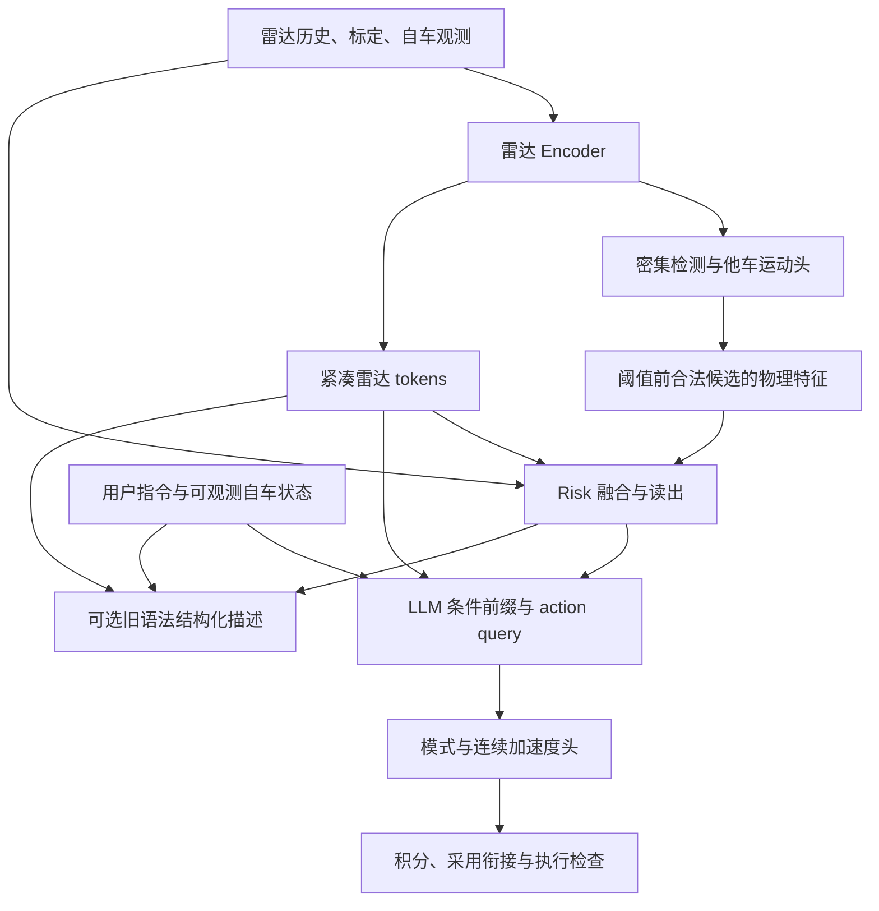
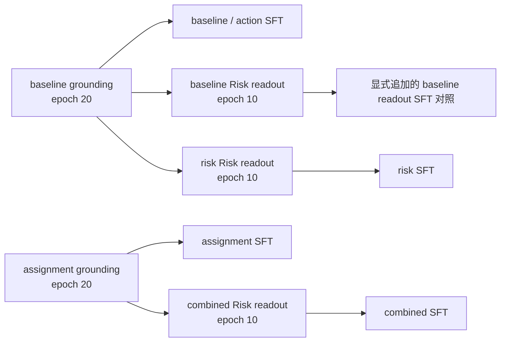

# RadarVLA 本轮代码改动详细说明

_2026-10-23 · 面向模型研发、实验复现和服务器测试 · 以实际提交代码为准_

---

本文解释本轮具体修改了哪些模块、为什么修改、数据如何经过新结构，以及哪些能力已经验证。
描述的实现提交是 `0bf250d59f015cb383aec72fecff59f2eb1ff94a`，相对基线为
`959e69aba30878d8e09954b555fe1c916843a9d1`，所在分支为 `codex/bottleneck-fixes-20261023`。

本轮的主要变化是：保留雷达感知和大模型决策的整体分工，改进检测训练分配，
给 Risk 增加预测物理关系，并增加由 LLM 决策特征驱动的连续自车轨迹输出。
同时修复生成缓存、采用时刻的轨迹衔接、输入协议和规划排队问题，提供五组八卡实验配置。

本文侧重实现原理；实际服务器命令与运行顺序见
[8×L40S 实验手册](BOTTLENECK_8XL40S_RUNBOOK.md)。
原始瓶颈证据与后续实验假设见 [瓶颈分析](BOTTLENECK_REPAIR_V1.md)。

## 📋 1. 改动范围与当前完成状态

### 1.1 本轮交付了什么

| 改动 | 旧行为或问题 | 当前实现 |
| --- | --- | --- |
| 检测监督分配 | 按固定 anchor 到 GT 的距离分配 | 可选局部预测质量一对一分配 |
| Risk 输入 | 雷达特征与编码自车状态 | 保留原路径，增加预测目标物理关系 |
| 自车动作表示 | 自回归生成量化坐标，再解码样条 | 可选 LLM query 一次输出连续加速度并积分 |
| 描述与动作 | 共用同一结构化 token 序列 | 新动作先算出，描述可选、耗时单列 |
| HF 生成 | 每步重复处理完整前缀 | 可选 KV cache，逐观察独立缓存 |
| 轨迹采用 | 新旧轨迹的初态可能不连续 | 固定时长五次多项式衔接并检查极值 |
| 规划排队 | 按 FIFO 处理每一帧 | RL 重放可选最新已就绪观察 |
| RL 观察 | 过滤观察时可能丢失协议字段 | 保留版本标识，继续隔离 GT 标签 |
| 实验入口 | 分散配置与启动参数 | 五组模型、三个阶段、八卡预检与初始化链 |
| 可复现记录 | seed 难以证明实际输入顺序一致 | 记录初始权重与每 rank 实际样本顺序哈希 |

### 1.2 完成状态的含义

| 状态 | 已有证据 | 不能由此推导的结论 |
| --- | --- | --- |
| 代码已实现 | 新模块、配置、训练与推理接线已提交 | 新模型必然优于旧模型 |
| 本地验证通过 | 683 项测试，含微型真实 Qwen、BF16/LoRA、两进程 DDP 与恢复 | 已完成八张 L40S 实机训练 |
| 启动配置就绪 | 十条八卡启动路径 dry-run 通过 | 3B 模型显存与吞吐已实测 |
| 旧 token RL 保留 | 缓存、衔接、调度等回归通过 | 连续动作的 RL 已完成 |

本轮没有产生真实数据重训后的新成绩。连续动作支持 SFT、预测和离线评估；
连续策略的分布、动作密度和概率重评分尚未实现，现有 token RL 会明确拒绝该格式。

默认模型配置仍是旧路径：`anchor_v1`、`radar_v1`、`token_spline_v1`。
三项结构改进通过配置显式启用，不会因为更新源码就自动给旧 checkpoint 接上随机新模块。

## 🏗️ 2. 瓶颈依据与整体架构

### 2.1 为什么修改这三个位置

以下数字来自基线提交中的历史归档复算，复算入口为
[audit_bottleneck_evidence.py](../scripts/audit_bottleneck_evidence.py)。
这里的 C0/A/B 是历史实验组名称，与本文后面表示 batch size 的符号 B 无关。

| 历史证据 | 可支持的判断 |
| --- | --- |
| 同一 1451 帧验证集中，.5/1/2s 危险正例仅 13/15/22 帧 | 总体平均 loss 容易掩盖短时危险漏报 |
| 阈值 .5 时 C0 找回 0/0/1，A 为 0/0/3，B 为 0/0/9 | 部分时域召回上涨不能代表全局改进 |
| .5s 召回至少 80% 时，探索得到的最少误报帧为 C0 35、A 105、B 192 | 提高单阈值召回不代表排序改善；改权重也可能增加同召回下的误报 |
| 同一 1213 个共同检出目标的未来 ADE 为 2.09193/2.11080/2.22730m | Risk 改动需要同步检查运动预测退化 |
| 历史 SFT 的 8464 个共同评价点，free/teacher-forced numeric/codec/CV ADE 为 1.1293/.3527/.1699/.9223m | 自回归数值动作存在值得独立排查的误差 |
| 历史 B 与 C0 的实际训练样本顺序不同 | 相同 seed 不足以排除实验混杂 |

这些证据提出了三个需要实测的假设：检测候选是否受到更合适的监督，Risk 是否能够利用
已有预测中的危险几何，以及连续动作接口是否能减少数值生成误差与动作等待。
它们没有证明三个改动必然解决所有问题。尤其 .5/1s 正例仅来自一个 episode，
不能把相邻帧当成大量独立危险事件。

### 2.2 各模块的分工

下图表示组合方案；单项实验只启用对应分支。



LLM 仍参与自车决策：动作头读取 LLM 的最后一个 action query 隐状态。
他车未来轨迹由雷达 Grounder 的运动头预测，不需要先让 LLM 生成文本。
新 Risk 分支使用这些预测关系，但动作 query 没有直接读取 GT 目标列表或 GT 未来轨迹。
输入处理链的严格因果性仍需单独核验；当前 Doppler unfold 的后续帧依赖尚未在本轮修复。

### 2.3 数量与形状的约定

为避免将批量大小、目标数和描述上限混淆，本文使用以下符号：

| 符号或参数 | 含义 |
| --- | --- |
| B | 一次前向的样本数，即 batch size |
| T | 历史雷达帧数；本轮服务器配置为 4 |
| K | 密集候选数，等于检测网格高度 × 宽度 × 每格槽位数 |
| Nᵢ | 第 i 帧经过阈值与 NMS 后保留的预测目标数 |
| H | 未来采样点数；本轮为 6，时刻 .5/1/1.5/2/2.5/3s |
| `max_agents=8` | 当前语言结构化描述的目标容量；也保留旧 query 模型相关兼容用途 |

密集检测的 K 不由 `max_agents=8` 决定。当前每格两槽，
`detection_max_candidates` 和 `detection_max_objects` 均为 `null`，不额外硬截断为八个。
架构仍有 K 个候选的有限表达容量，并非数学上的无限目标数。

## 🔍 3. 检测训练：局部质量一对一分配

实现入口：[loss_grounding](../src/losses.py)、
[local_quality_assignment](../src/detection_assignment.py)、
[RadarVLAGrounder](../src/model.py)。

### 3.1 保留的感知和他车运动头

本轮没有替换已有密集检测器，也没有把第一阶段改成调用 LLM。
[DenseRadarDetector](../src/detection.py) 继续输出每个候选的存在分数、位置、尺寸、朝向、
径向 Doppler、地面速度以及未来位置/速度。其未来位置仍按下式构造：

```text
他车未来位置(t) = 当前预测位置 + 当前预测地面速度 × t + 学习的位置残差(t)
他车未来速度(t) = 当前预测地面速度 + 学习的速度残差(t)
```

本轮改变的是“训练时哪个候选负责哪个真实目标”，而非另写一套他车轨迹预测器。

### 3.2 旧分配和新分配

旧 `anchor_v1` 根据固定 anchor 中心与 GT 中心的距离做全局 Hungarian 一对一匹配。
若一个邻近候选已经预测得更准确，它不一定因此获得该目标的正监督。

新策略 `local_quality_v1` 分为五步：

1. 对每个 GT，找到距离最近的固定 anchor 所在网格。
2. 取该格周围 3×3 邻域中的全部槽位，边缘裁剪，不跨行错误连接。
3. 与模型合法候选 mask 取交集；不按 objectness 分数提前筛除。
4. 对局部候选计算预测质量代价，进行一对一匹配。
5. 若局部图无法覆盖所有目标，整帧回退到全局 anchor 距离匹配，并记录回退数量。

已知框的匹配代价为：

```text
cost(i,j) = ||预测中心_i - GT中心_j||₂ / 2m + (1 - 旋转框IoU(i,j))
```

框尺寸或朝向标签未知时，只使用中心距离项，不补造一个 IoU。
IoU 是 BEV 有向矩形的几何重叠，沿用现有 `rotated_iou` 实现。
匹配过程不参与梯度传播，不使用预测置信度、预测未来轨迹或 GT future 决定匹配。
完成匹配后，原检测和运动损失继续监督各自对应的候选。

每个有效 GT 只产生一个正匹配，避免引入多正例后同时改变运动监督权重。
如果全部合法候选本身已经少于 GT 数量，会显式报错，不能静默丢弃一部分 GT。

### 3.3 预热、未知标签与诊断

| 配置 | 默认旧路径 | assignment/combined |
| --- | --- | --- |
| `model.detection_assignment_policy` | `anchor_v1` | `local_quality_v1` |
| `model.detection_assignment_warmup_epochs` | 对旧策略无切换作用 | 2 |

训练前两个 epoch 使用旧分配，第三个开始使用新分配；验证始终按配置使用新策略。
新策略对完全重合目标的排序仅使用已知当前字段，并用稳定 `agent_ids` 解平局。
未知速度、类别、框尺寸或朝向中的占位值不会改变目标对应关系。
旧策略保留原排序行为；新策略即使回退，也继续使用新排序，因此重合目标的 tie
不保证逐个等于历史旧策略。

每个 rank 的训练记录增加以下计数：

| 字段 | 含义 |
| --- | --- |
| `assignment_frames` | 实际发生匹配的有目标监督帧数 |
| `local_quality_frames` | 使用局部质量策略的帧数，包含随后回退者 |
| `anchor_fallback_frames` | 局部匹配无法覆盖后回退的帧数 |
| `anchor_fallback_targets` | 回退帧中参与匹配的目标数 |

### 3.4 推理目标数与类别的边界

推理仍由 `decode_detections` 进行合法候选筛选、objectness 阈值和 NMS，
最后 `Nᵢ = len(detectionsᵢ)`，不从标签读取真实数量。当前配置阈值为 .5，NMS IoU 为 .3。

本轮五组配置使用 `detection_class_schema='agent_v1'` 和
`moving_vehicle_01_background_v1` 数据选择策略。这是当前单类 agent 实验；
输出 `num_agents` 有意义，`num_vehicles` 则为 `null`，不能把它写成已验证的多类别车辆计数。
现有 `legacy4_v1` 四类接口保留，但车辆、行人、骑行者和其他目标的完整覆盖需要匹配的
标签、训练配置和验证数据；静止车辆等当前被作为背景的对象也不能由本轮成绩代表。

## 📐 4. Risk：加入预测目标的物理关系

实现入口：[PredictedGeometryRiskFusion](../src/risk_fusion.py)、
[radar_vla.model](../src/model.py)、[训练与初始化流程](../src/pipeline.py)。

### 4.1 新旧路径及输出语义

旧 `radar_v1` 使用 Risk query 从雷达 tokens 读取特征，再结合编码后的自车状态输出 Risk。
新 `predicted_geometry_v1` 保留这一通路，额外对所有合法密集候选构造物理特征，
经过共享 MLP 和注意力读取后与原雷达 Risk 特征融合。

```text
radar_context = Attention(Risk query, radar tokens)
candidate_features = PhysicalFeatures(detector predictions, observed ego)
geometry_context = Attention(Risk query, CandidateMLP(candidate_features))
fused_context = radar_context + FusionMLP(concat(radar_context, geometry_context))
Risk = RiskHead(concat(fused_context, encoded ego))
```

输出仍是 `[B,5]`，没有增加新的 Risk 标签定义。当前 KRS-v2 配置的前三项是
.5/1/2s 碰撞分数，经 sigmoid 输出；后两项为 dmin 与所需减速度 areq（m/s²），经 softplus 输出，
当前几何标签时域为 2s。这些分数没有因为加入新结构就自动完成概率校准。

Risk 监督仍使用既有碰撞 focal、dmin/areq 的 masked SmoothL1，以及跨时域单调约束；
本轮五组配置没有另改这组 loss 权重，也没有将碰撞 loss 自动换成 BCE。
独立比较概率损失与校准方法仍属于后续实验。

### 4.2 候选物理特征

输入张量包括 `detection_state[B,K,5]`、框尺寸 `[B,K,2]`、朝向 `[B,K]`、
objectness `[B,K]`、未来位置和速度 `[B,K,H,2]`，以及自车当前观测和未来采样时刻。
`detection_state` 顺序为 `[x,y,vr,vx,vy]`：vr 是相对传感器的径向 Doppler；
vx/vy 是当前自车坐标系中的地面速度。二者不能互相替代。

每个候选的特征维度为 `20 + 10H`，H=6 时为 80：

| 分组 | 包含内容 |
| --- | --- |
| 当前 20 维 | 位置、地面速度、相对自车速度、径向 Doppler、尺寸、cos/sin 朝向、objectness、自车 v/a/yaw rate、点到框距离、range、closing speed |
| 每个未来时刻 10 维 | 目标预测位置、相对自车 CV/CTRV 位置、预测地面速度、相对速度、点到框距离、时刻 |

位置按 `range_scale`、速度按 `doppler_scale` 归一化，尺寸按 10m、
加速度按 5m/s²、时间按 3s 归一化。自车参照运动是当前观测速度与 yaw rate 下的 CV/CTRV，
不读取 GT 自车未来。

这里的点到框距离是**自车中心点到预测目标有向框**的距离，不包含自车尺寸；
未来框沿用该目标当前预测朝向。既有 dmin 标签使用的车辆间几何信息更完整，
因此该输入特征不是标签 dmin 的精确重算，更不是解析碰撞判定器。
RiskHead 仍需从这些特征中学习最终输出。

### 4.3 全候选融合与梯度边界

该分支使用阈值前全部合法候选，不经过 NMS，不做 top-8，不按 score>.5 截断，
也不使用 GT 匹配来挑选输入。低置信度仍作为一项特征提供给 MLP。
无合法候选的样本使用空集合哨兵，避免注意力全 mask 产生不稳定结果。

预测几何经过 detach：Risk 损失不能通过这个新增几何输入直接改动检测输出头。
这防止检测器把“看似物理的数值”变成任意传递 Risk 信息的编码。
融合 MLP、注意力和 RiskHead 可训练，原雷达通路仍保留梯度。
因此，在非冻结的联合训练下，Risk 依然可能通过原雷达路径更新共享 encoder；
“几何 detach”不等于整个 Grounder 已冻结。

### 4.4 冻结读出实验及权重迁移

新增 `--risk-readout-only`，仅用于 grounding 阶段。它从显式指定的 Grounder checkpoint
初始化，冻结非 Risk 参数并保持感知模块 eval，只训练：

- `risk_query`
- `risk_attention.*`
- `risk_head.*`
- 新结构中的 `risk_fusion.*`

旧 → 新迁移只允许新增融合参数及对应协议标识缺失；原检测、运动和 encoder 权重必须完整。
源阶段、数据指纹、数据配置和除 `risk_input` 之外的模型配置必须一致。
同为新结构的 checkpoint 缺少任何权重时会报错，不能静默随机补齐。
普通 `load_models` 不承担跨结构迁移。仅缓存雷达 context 而缺少候选预测的旧 Risk
读出路径，也不能直接运行新的物理融合模块。

## 🧠 5. 自车规划：LLM 决策特征与连续轨迹头

实现入口：[action_head.py](../src/action_head.py)、[planner.py](../src/planner.py)、
[hf_planner.py](../src/hf_planner.py)、[pipeline.py](../src/pipeline.py)。

### 5.1 对旧 token 动作做了什么改变

旧 `token_spline_v1` 将结构化模式、道路、目标和自车控制点按 token 序列生成。
坐标通过有限 bins 表达，自车轨迹由解码的控制点构造样条。

新 `parallel_acceleration_v1` 在可观测条件后增加自车状态 token 和可学习 action query。
一次 LLM 前向获得 query 隐状态，再由模式头和连续动作头输出：

| 输出 | 形状 | 作用 |
| --- | --- | --- |
| 模式 logits | `[B,2]` | SHORT/LONG |
| 加速度残差 | `[B,6,2]` | 六个未来时刻的二维残差 |
| 积分位置 | `[B,6,2]` | 自车未来轨迹 |
| 加速度节点 | `[B,7,2]` | 包括当前初始加速度 |

动作残差头采用 Linear → GELU → Linear，最后产生 12 个连续数值。
“并行”表示六个未来残差同时输出，不需要生成一个坐标 token 后再生成下一个；
仍需随后按时间顺序做六步小张量积分。

LLM 接收雷达 tokens、预测 Risk、用户指令和可观测自车状态。
action query 不接收 teacher-forced 世界描述、GT 模式前缀、GT Risk 或 GT future。
Risk 融合启用时，预测目标关系通过 Risk 分支影响动作，而非将 GT 目标直接送进动作头。

### 5.2 初始状态、约束与积分

接口 `observed_ego` 包含当前二维速度、yaw rate，以及可选二维加速度和有效 mask。
缺失或无效的速度会被拒绝；加速度缺测时使用 CV/CTRV 估计，并在输出中标记
`acceleration_source='ctrv_fallback'`。当前位置在当前自车坐标系中为零。
未来时间必须显式为 `.5,1,1.5,2,2.5,3s`。

设间隔 Δt=.5s，CV/CTRV 基线加速度为 a_base，网络残差为 δa：

```text
候选总加速度 a* = Proj_A(a_base + δa)
下一节点 a[k+1] = a[k] + Proj_(J·Δt)(a* - a[k])
段内 jerk j[k] = (a[k+1] - a[k]) / Δt

p[k+1] = p[k] + v[k]·Δt + 0.5·a[k]·Δt² + j[k]·Δt³/6
v[k+1] = v[k] + a[k]·Δt + 0.5·j[k]·Δt²
```

`Proj_R` 将二维向量投影到半径 R 的范数球内，约束的是总向量范数，
不是分别裁剪 x/y，也不是只限制残差。默认 A=8m/s²、J=20m/s³。
有效初态下，节点间加速度线性变化，位置、速度、加速度连续。
初始加速度超限时保留真实初态并标记不可行，不通过瞬间裁剪制造可行轨迹。

六段投影和积分使用 float64，防止饱和边界的 float32 舍入触发执行器误拒。
Transformer 和动作 MLP 仍按配置精度运行；这些双精度小张量不会把整个 LLM 改成双精度。
二维 A/J 约束仍未表达完整车辆非完整约束、转向执行器、曲率或路界限制。

### 5.3 SHORT 与 LONG 的执行含义

动作头总是计算六个节点；adaptive 模式取模式 logits 的 argmax。
LONG 导出六点、原生时域 3s；SHORT 导出前两点、原生时域 1s。
`always_long` / `always_short` 可按既有配置固定模式。

新 SHORT 的终点加速度不一定为零，不能直接套用旧自然样条的零终端加速度假设。
执行器先用受限 jerk 将加速度释放到零，再按受限停车延续到静止。
原生轨迹时域与执行延续时域分别记录；延续不要求新增未来标注，也不能冒充监督范围扩大。
执行、导出、响应检查和重放共享同一采样器，不将新格式重新解释为自然三次样条。

### 5.4 SFT 损失和有效标签

连续分支的训练总目标为：

```text
L_total = L_grounding
        + ego_trajectory_weight · L_position
        + action_mode_loss_weight · L_mode
        + action_description_loss_weight · L_description
```

本轮连续配置后两项权重为 1 和 .1，位置权重沿用 `ego_trajectory_weight=1`。

- `L_position` 是有效点二维 SmoothL1 之和，再除以有效点数。GT 模式已知为 SHORT 时仅监督前 1s；模式未知仍可使用有效轨迹标签。初态不可行样本不参与位置项。
- `L_mode` 仅在模式标签有效时计算 CE；模式未知不会被伪造为 LONG 或 SHORT。
- `L_description` 沿用原 token 监督，但屏蔽自车数值字段；道路、目标和有效结构化描述仍接受监督。action query 的前向独立于 teacher token 前缀。

连续分支不调用旧 `planner_physics_loss`；旧配置中可能仍保留的
`ego_initial_velocity_weight`、`agent_trajectory_weight` 等旧物理损失权重，不直接形成新动作损失。
当前也没有 `action_velocity_loss_weight` 配置项，没有把稀疏位置差分当作瞬时速度 GT。
初始状态和 A/J 约束主要通过表示与积分结构实现，未新增一套碰撞或道路约束 loss。

八卡 SFT 默认冻结 Grounder，其 grounding loss 仍会计算、报告，但不更新感知参数。
规划侧更新 action head/query、状态与雷达/Risk adapters、描述 embedding/head 和启用的 LoRA。
验证报告的 `action_components` 单列位置项、模式项、描述项、有效点/模式数和无效初态数；
其中 loss 是按样本加权的 batch 均值，count 则累加，不应误读为全局逐点重新加权的 loss。

### 5.5 描述分支与 RL 的支持范围

新动作的默认推理调用 `plan_action`，不执行自回归循环，`generated_tokens=0`。
这表示没有逐 token 动作生成，仍然经过了一次 LLM 前向。

`predict --include-description` 在该批所有动作都已算出后，另行调用原 `generate/decode`。
当前仍使用完整旧语法，内部仍可能生成自车数字；最终只导出道路、目标和相关结构字段，
这些旧 ego 数值不作为执行动作。这还不是专门删减过的纯描述 grammar。

描述模式与动作模式分别预测，可能不一致；描述的 `valid` 仅表示其解码状态，
不能替代动作可执行性。模式为 LONG 时，道路描述沿用多段中心线与宽度；
当前这套 grammar 不输出显式左右边界或邻接关系，不能与历史分支中的多车道协议混同。
各道路段输出序号、中心线控制点/采样点、宽度及完整性，仍受配置容量和标签范围限制。

现有 RL 对离散 token 计算采样概率、KL 与重评分，不能据此给确定性连续加速度赋予概率。
因此 action/combined 的 `train-rl`、`evaluate-rl` 与 token 策略评分会明确拒绝。
后续需要实现连续策略分布、对应动作密度与一致的重评分，才能将响应 RL 接到新动作头上。

## ⏱️ 6. 执行衔接、生成缓存与响应调度

### 6.1 在实际采用时刻衔接轨迹

实现：[adoption.py](../src/adoption.py)、[execution.py](../src/execution.py)。

模型生成期间自车继续运动。旧自然样条的零初始加速度与转弯 CV/CTRV 基线可能不匹配，
导致新计划即使控制点看起来合理，也在采用瞬间被连续性检查拒绝。

新增采用过渡时长 `adoption_transition_s`。旧协议默认 0；本轮旧 token RL 实验配置取 .5s，
新动作的 `action_adoption_transition_s` 也默认 .5s。适配器在采用时刻读取旧执行轨迹的
位置、速度、加速度和朝向，用五次多项式连接到新轨迹本地 τ 时刻的 p/v/a。
τ 之后继续原轨迹，不修改原生预测终点。

五次多项式不仅检查离散采样点，也求加速度/jerk 范数的内部极值；超限或时域不允许时拒绝。
已经连续的轨迹可以不做额外桥接。拒绝的计划不因“尝试过修改”获得已采用响应的计时。

普通独立帧预测没有历史执行计划时，延迟基线仍是观测 v/yaw 下的 CV/CTRV，
不完整表达真实执行中的纵向加速度。实时控制必须提供实际执行状态，不能将此离线近似
解释成已经实现车辆控制器。

### 6.2 HF 自回归生成缓存

实现：[HFRiskConditionedPlanner](../src/hf_planner.py)、
[共享生成循环](../src/planner.py)、[rl_policy.py](../src/rl_policy.py)。

`language_model.generation_use_cache` 默认 false；本轮五组配置统一为 true。
第一步对连续条件、指令和 BOS 做 prefill，后续只送入一个新 physical token，复用 KV。
RoPE 位置按有效 token 计数，缓存槽位仍考虑 padding；不同观察不共享历史缓存。

greedy、RL 采样与固定动作计时重放共用此生成实现，训练与概率重评分保留完整序列路径。
它主要减少旧 token 动作和可选描述的重复前缀计算；新连续动作本身只有一次 query 前向，
不能把连续动作的加速全部归因于 KV cache。

### 6.3 最新已就绪观察与输入协议修复

实现：[response_rl.py](../src/response_rl.py)、[response_clock.py](../src/response_clock.py)、
[response_replay.py](../src/response_replay.py)。

新增 `planner_observation_policy`：默认 `fifo`，实验配置为 `latest_ready`。
规划器空闲时，仅从当前已经感知就绪的观察中选择最新帧，跳过尚未开始处理的旧帧；
没有就绪帧则等待，不取消已经开始的生成，也不读取未来观察。

首次检测时钟不会因跳帧而重置。训练重评分使用实际选中帧的 `frame_index`，
避免将新动作与被跳过的旧观察错误配对，并记录观察年龄与跳帧信息。
该策略目前只用于响应 RL 事件重放；感知预处理仍按 FIFO 计时，普通 predict 没有场景级
持续执行状态，也不是完整的传感器到控制器调度服务。

同时，`_observation` 继续过滤 GT 标签，但保留 `risk_horizon_schema_id` 和
`detection_class_schema_id`。它们是输入版本契约，不是监督标签；删除它们会导致新协议
观察无法通过模型检查。未来目标轨迹、GT Risk 和 GT 地图仍不因此进入规划输入。

### 6.4 响应时间与当前计时范围

响应时钟从首次检测报告开始，以新旧计划出现持续变化的时刻为终点，不要求等待完整未来
标签覆盖才能识别变化。默认变化条件是纵向加速度差绝对值至少 .5m/s²，或横向位置差
绝对值至少 .3m，持续 .1s；采样步长 .05s，并加入关键动力学时刻。
因此加速与制动都可能被计为“改变”，改变本身不等于有效安全避让。

事件反应时间记录为 `reaction_s = waiting_s + generation_s + action_onset_s`，起点已经是
首次检测报告，因此不再重复加上此前感知用时；感知耗时仍影响计划采用时车辆的实际状态。
代码分别检查响应是否出现、计划是否可执行和已有证据是否支持有效性；
无意义抖动、无害场景误动作、超限或已知碰撞不能仅靠更早改变获得优待。

普通 `prediction_rows` 的时间字段如下：

| 字段 | 当前含义 |
| --- | --- |
| `detection_seconds` | 当前批 Grounder 前向与检测解码耗时 |
| `waiting_seconds` | 同批逐样本规划等待及期间已经发生的处理开销 |
| `generation_seconds` | 单样本动作生成与解码，CUDA 同步计时 |
| `plan_adoption_timestamp_s` | 观察时刻加感知、等待、生成时间的计划采用时刻估计 |
| `description_seconds` | 可选描述的独立生成/解码耗时 |
| `amortized_inference_seconds` | 该批动作与执行导出处理总耗时除以样本数，不含之后的可选描述 |

采用桥接和执行检查的 CPU 开销没有计入当前样本的 `generation_seconds` 或采用延迟估计，
通信与真实控制器开销也未计入。后一个样本的排队时间可能包含前一个样本的执行导出工作。
因此应按具体字段解释结果，不能把某个模型前向耗时直接称为实车完整端到端反应时间。

`predict_checkpoint` 会汇总所有结果后统一写 JSONL。动作先于描述在计算上可得，
但本轮没有实现动作完成即异步发布的在线接口。

## ⚙️ 7. 训练组织、八卡配置和复现记录

### 7.1 五组实验如何区分

配置入口：[bottleneck_8xl40s.json](../configs/bottleneck_8xl40s.json)。

| 实验组 | 分配 | Risk | 动作 |
| --- | --- | --- | --- |
| [baseline](../configs/bottleneck_v1/baseline.json) | anchor | 原雷达路径 | token 样条 |
| [assignment](../configs/bottleneck_v1/assignment.json) | 局部质量 | 原雷达路径 | token 样条 |
| [risk](../configs/bottleneck_v1/risk.json) | anchor | 预测物理融合 | token 样条 |
| [action](../configs/bottleneck_v1/action.json) | anchor | 原雷达路径 | 连续加速度 |
| [combined](../configs/bottleneck_v1/combined.json) | 局部质量 | 预测物理融合 | 连续加速度 |

共同条件包括 TroDNet、4 帧 `[2,256,107]` 雷达输入、KRS-v2 moving 数据、
本地 Qwen2.5-3B、LoRA、BF16、KV cache 和相同道路分段描述格式。
本轮没有统一替换原单车道/多车道历史对照分支。

### 7.2 三阶段预算与初始化链

| 阶段 | 轮数 | 每卡 batch × 累积 | 八卡有效 batch | 学习率 |
| --- | --- | --- | --- | --- |
| grounding | 20 | 1×1 | 8 | 2e-4 |
| risk-readout | 10 | 1×1 | 8 | 2e-4 |
| sft | 5 | 1×4 | 32 | 5e-5 |

seed=42，每 rank 两个 worker，按 optimizer update 执行 flat-cosine 调度；
前 5/2/1 个 epoch 分别保持平坦，之后衰减到初始学习率 .1 倍。
SFT 冻结 Grounder，每轮默认选择至多 32 个固定验证样本做自由生成。

默认初始化链为：



baseline/action 的默认 SFT 使用同一个 grounding epoch 20，便于比较动作表示。
Risk 结构应先比较 baseline/risk 同样十轮的冻结读出结果。
若比较 Risk 对下游规划的贡献，需要再用 baseline/readout epoch 10 初始化一个 token SFT
对照；默认 baseline SFT 没有这额外十轮，不能省略这一差异后声称单变量因果贡献。
combined 同时变化多项，应作为组合可行性实验，不能据它单独归因各模块。

默认选固定最终 epoch，不自动挑各组最优 `best.pt`。自定义 profile 改动轮数时，
初始化路径跟随源阶段的 `epochs`；显式 `--init-grounding` 可以覆盖。

### 7.3 启动检查和可复现记录

实现：[bottleneck_campaign.py](../scripts/bottleneck_campaign.py)、
[radarvla_cli.py](../scripts/radarvla_cli.py)、[launch_l40s.sh](../launch_l40s.sh)。

```bash
bash scripts/radarvla.sh bottleneck --arm baseline --stage grounding --dry-run
bash scripts/radarvla.sh bottleneck --arm action --stage sft --dry-run
bash scripts/radarvla.sh bottleneck --arm combined --stage risk-readout --dry-run
```

正式运行复用原训练入口，检查 validation 状态为 PASS 且 manifest SHA256 匹配、
初始化文件、所需本地模型文件、CUDA 设备数和逐设备原生 BF16 支持。
dry-run 只展开命令，不训练或探测 GPU，不能替代这些正式检查。

| 记录 | 内容与用途 |
| --- | --- |
| 标准输出 `CAMPAIGN` JSON | profile SHA、实验组、GPU、路径、预算、有效 batch |
| `protocol.json` | 冻结的训练配置、数据与模型来源等协议 |
| `initialization.json` | 源 checkpoint SHA、训练前可训练参数名称/形状/类型/字节哈希 |
| `metrics.jsonl` / checkpoint history | 每轮实际样本顺序哈希、逐 rank 匹配回退计数、验证指标 |
| optimizer 学习率序列 | 按实际 update 记录调度 |
| `peak_allocated_mib_by_rank` | 逐 rank 实际显存峰值；CPU 测试为 null |
| `supervision_summary.json` | 模式监督数量与固定生成验证样本 |

样本顺序哈希按实际消费的 sample_id 顺序累积，每个 ID 以换行分隔。
初始化哈希仅覆盖可训练参数；SFT 冻结感知时还应结合源 checkpoint 哈希确认感知来源。
DDP sampler 的补齐/划分也会影响实际序列，因此八卡 baseline 必须重跑，不能把历史单卡
结果直接当成本次严格对照。`--gpus` 改少于八卡会改变有效 batch，并在启动输出中提示。

## 📦 8. 接口、checkpoint 与文件索引

### 8.1 主要配置新增项

| 所属 | 配置项 | 含义 |
| --- | --- | --- |
| model | `detection_assignment_policy` | anchor 或局部质量匹配 |
| model | `detection_assignment_warmup_epochs` | 新分配训练预热轮数 |
| model | `risk_input` | `radar_v1` / `predicted_geometry_v1` |
| planner | `action_representation` | token 样条 / 连续加速度 |
| planner | `action_max_acceleration_mps2` | 默认 8 |
| planner | `action_max_jerk_mps3` | 默认 20 |
| planner | `action_mode_loss_weight` | 默认 1 |
| planner | `action_description_loss_weight` | 默认 .1 |
| planner | `action_adoption_transition_s` | 新动作采用过渡，默认 .5s |
| language_model | `generation_use_cache` | 默认 false，五组实验 true |
| response RL | `planner_observation_policy` | 默认 fifo，实验 latest_ready |
| response RL reward | `adoption_transition_s` | 默认 0，实验 .5s |

`--risk-readout-only`、`--freeze-grounder` 是训练控制；`--include-description` 是预测控制。
具体 schema 和数值约束以 `ModelConfig`、`PlannerConfig` 和 `ResponseRLConfig` 为准。

### 8.2 新动作结果的字段含义

新 `plan.schema` 为 `radar_vla_parallel_acceleration_v1`，表示必须用新的加速度采样器。

| 字段 | 含义 |
| --- | --- |
| `mode` | short 或 long |
| `ego_times_s` / `ego_trajectory` | 原生时域的采样时刻和积分位置 |
| `initial_velocity_mps` | 重建动作所需的初始速度 |
| `control_times_s` / `acceleration_knots_mps2` | 包含 t=0 的加速度节点 |
| `action_limits` | 这条计划使用的 A/J 约束 |
| `acceleration_source` | observed 或 ctrv_fallback |
| `mode_probabilities` | SHORT/LONG 两项概率 |
| `native_horizon_s` / `dynamics_times_s` | 原生终点与动力学边界检查时刻 |
| `valid` / `ego_complete` / `failure_reason` | 原生动作有效状态；不等于碰撞安全 |

`plan` 是原始生成计划；`executed_plan` 是考虑延迟与采用检查后的执行导出。
`description` 是可选外层字段，与动作分开，不能当作新的执行计划。
原生计划的 `description_available=False` 不会因外层后来附带描述而被改写；
下游应直接检查是否存在外层 `description`。

### 8.3 checkpoint 兼容原则

Risk 新结构加入 `_risk_input_contract`，动作新结构加入 `_action_representation_contract`。
跨 schema 的隐式加载会失败，即便调用者试图使用 `strict=False` 也不能绕过关键协议检查。
旧默认模型保留原参数及输出契约；检测网格元数据只在新局部策略下输出。

只有显式 Risk readout 初始化允许兼容的旧雷达 Risk → 新融合迁移；
旧 token 规划 checkpoint 没有自动变成新连续动作 checkpoint 的路径。
八卡 action 实验从指定感知权重和本地 Qwen 构建新 SFT 模型，不继承一套未声明来源的旧 SFT 动作头。
改变配置不能作为原实验的 `--resume`；恢复仍需原协议、数据和权重来源一致。

### 8.4 代码阅读入口

| 文件 | 本轮职责 |
| --- | --- |
| [detection_assignment.py](../src/detection_assignment.py)、[losses.py](../src/losses.py) | 局部分配、回退与监督接线 |
| [risk_fusion.py](../src/risk_fusion.py)、[model.py](../src/model.py) | 预测物理特征、融合与冻结读出 |
| [action_head.py](../src/action_head.py) | 连续动作、损失、JSON 重建与停车延续 |
| [planner.py](../src/planner.py)、[hf_planner.py](../src/hf_planner.py) | action query、描述分支、HF 缓存 |
| [adoption.py](../src/adoption.py)、[execution.py](../src/execution.py) | 采用桥接、动力学检查和统一采样 |
| [evaluation.py](../src/evaluation.py) | 新动作格式的评估采样与语义标记 |
| [response_clock.py](../src/response_clock.py)、[response_reward.py](../src/response_reward.py)、[response_replay.py](../src/response_replay.py) | 持续变化计时、有效性判断与重放 |
| [response_rl.py](../src/response_rl.py)、[rl_policy.py](../src/rl_policy.py) | 观察协议、调度、token RL 格式保护 |
| [pipeline.py](../src/pipeline.py)、[__main__.py](../src/__main__.py) | 训练、迁移、验证、预测与 CLI 参数 |
| [bottleneck_campaign.py](../scripts/bottleneck_campaign.py) | 八卡实验预算与初始化命令展开 |

## 🧪 9. 测试证据与服务器验收方式

### 9.1 已完成的本地验证

实现提交在 2026-10-23 使用本机 `.conda` 完整运行：

```bash
CUDA_VISIBLE_DEVICES='' OMP_NUM_THREADS=1 .conda/bin/python -m pytest -q tests
```

结果为 **683 passed，102.90s**。这是实现提交已有的验证记录，本文编写属于文档修改，
不把它表述为再次进行真实数据训练。测试日志、JUnit 与文件哈希记录在本机忽略目录
`artifacts/bottleneck_fixes_20261023/`；服务器环境仍使用其 `local_paths.json` 指定解释器。

| 测试文件 | 关键覆盖 |
| --- | --- |
| [test_detection_assignment.py](../tests/test_detection_assignment.py) | 邻域、旋转 IoU、一对一、回退、未知 mask、GT 顺序 |
| [test_risk_physical_fusion.py](../tests/test_risk_physical_fusion.py) | 全候选、空集合、无 GT 依赖、梯度、冻结与迁移 |
| [test_parallel_action.py](../tests/test_parallel_action.py) | query、积分、mask、A/J、SHORT 续接、JSON 与执行一致 |
| [test_parallel_action_hf.py](../tests/test_parallel_action_hf.py) | 真实本地微型 Qwen、BF16/LoRA、梯度与协议 |
| [test_bottleneck_training.py](../tests/test_bottleneck_training.py) | 原生训练重载、双进程 SFT、冻结感知、断点恢复 |
| [test_adoption_transition.py](../tests/test_adoption_transition.py) | 采用桥接、内部极值、不可行拒绝、共享执行语义 |
| [test_response_observation_contract.py](../tests/test_response_observation_contract.py) | 保留协议字段、过滤 GT |
| [test_response_scheduling.py](../tests/test_response_scheduling.py) | latest-ready 因果选择、跳帧与时钟 |
| [test_bottleneck_launcher.py](../tests/test_bottleneck_launcher.py) | PASS/hash 门控、dry-run、GPU 参数与自定义轮数初始化链 |

另完成十条八卡启动路径 dry-run、Shell 语法、`git diff --check`、隔离 Python 的 `pip check`
及 editable 导入路径检查。微型 Qwen 测试使用实际 Transformer 前向，但不是目标 3B 模型的
吞吐或显存验证；两进程 CPU DDP 也不是八卡 GPU 通信验收。

### 9.2 如何判断改动是否值得采纳

| 改动 | 应比较的内容 | 不能单独作为成功依据 |
| --- | --- | --- |
| 检测分配 | 固定 FP 预算危险目标召回、连续漏检时长、共同 GT 轨迹 ADE、回退率 | objectness loss 降低 |
| Risk 融合 | 同轮数读出对照、独立 episode 的短窗召回与误报、危险 dmin 和正 areq | 总体 Risk loss 或单一时域 AP |
| 连续动作 | 同点 ADE、停驻/起步分层、执行有效率、变化延迟、误响应与已知碰撞 | JSON 有效或 token 数变少 |
| 缓存与调度 | 固定动作/场景下的 P50/P95 延迟、观察年龄、跳帧和资源占用 | 仅比较平均前向耗时 |
| 组合方案 | 相同数据和预算的综合表现 | 直接将全部增益归因于某个单模块 |

阈值需要在独立校准 episode 上确定并冻结，不能在 test 上反复选取。
若新分配经常回退，应先分析网格覆盖与拥挤冲突；若 Risk 读出无收益，应检查危险信息是否
已在感知阶段丢失；若动作快但频繁被执行器拒绝，应检查初态、采用延迟与轨迹可执行性。

## 🔗 10. 仍未覆盖的工作与后续阅读

当前仍需要实测或后续实现的部分包括：目标 3B 模型与八张 L40S 的真实训练/延迟，
独立危险 episode 的泛化，完整多类别目标数据协议，连续策略 RL，因果传感器产品，
以及接入真实执行状态的异步在线控制链路。

新 Risk 特征中的点到框距离、CV/CTRV 基线和二维 A/J 约束都有明确近似范围；
本轮没有将它们升级为完整车辆动力学、道路约束或闭环碰撞安全证明。
这些限制应与测试结果一起解释，而不是在看到更低 loss 后省略。

| 想了解的内容 | 文档 |
| --- | --- |
| 本轮为何修改、历史数值依据 | [BOTTLENECK_REPAIR_V1.md](BOTTLENECK_REPAIR_V1.md) |
| 八卡更新、预检、训练与对照顺序 | [BOTTLENECK_8XL40S_RUNBOOK.md](BOTTLENECK_8XL40S_RUNBOOK.md) |
| 常用操作入口 | [RUNBOOK.md](../RUNBOOK.md) |
| 通用分布式设置 | [DISTRIBUTED.md](../DISTRIBUTED.md) |
| 原密集检测设计 | [DENSE_DETECTION.md](DENSE_DETECTION.md) |
| 响应事件、奖励与旧 token RL | [RESPONSE_RL.md](RESPONSE_RL.md) |

本文各项行为以实现提交及链接源码为依据；后续若修改损失、输入协议或执行采样器，
应同步更新本文对应章节，避免把设计意图当成仍然有效的实现说明。
