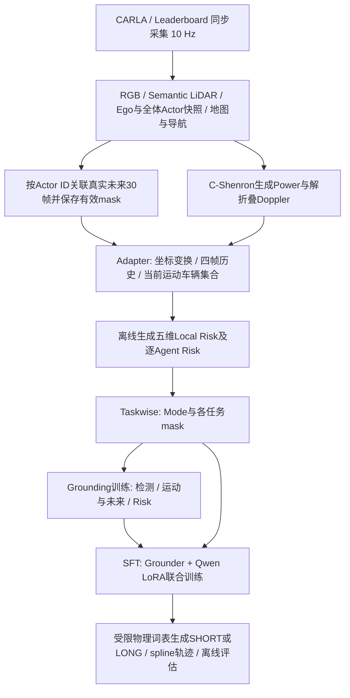

# RadarVLA 流程、框架与 Risk 标签复核

复核日期：2026-10-20，Asia/Shanghai。依据当前工作区源码、RUNBOOK、配置及本机可读数据产物；工作区已有未提交修改，本次不覆盖。仅新增本文，没有更改标签、模型或启动训练。

## 1. 当前状态及版本边界

- 当前发布策略：`moving_vehicle_01_background_v1`；数据为 `prepared/taskwise_moving_v1/manifest.jsonl`。
- 本次重新读取全部 manifest 并计算 SHA256：`6f2fdedd3cee3abd1fdc6ab9952b267ce5008aa2994aa014241d6b37a867672e`，与迁移状态、acceptance 和 validation 一致。
- 保存的迁移状态 COMPLETE，acceptance/validation 均 PASS；本次没有重跑全量传感器解码或全量几何验收。
- 9,841 帧，64 episodes；train/val/test 为 6,847/1,472/1,522，episode 两两交集为零；21,502 个 Agent 实例，111 帧超过 8 个。
- Mode：LONG 9,500，SHORT 331，UNKNOWN 10；保存验收记录 SFT 可用 9,831 帧。
- 三个 Pcol 有效标签数为 9,841/9,841/9,832，正例数为 95/206/332，分别约占各自有效标签的 0.97%/2.09%/3.38%。
- 旧 `docs/RADARVLA_PROJECT_SPEC.md` 的静止车保留、行人/自行车 ignore、590 个 SHORT 等属于前一版，不能直接用于描述 moving 数据。
- 本机现有正式两阶段 run 为 `taskwise_local_v1_20261017_003057`；未发现对应 moving 版本的两阶段训练目录。数据验收完成不代表新策略模型已训练。
- `range_control_20261019` 保存状态已完成，两组各 5 epochs；其协议仍为旧 Local/ignore 策略，不能作为 moving 版本效果。固定第 5 epoch：crop50 危险车辆召回 0.8772，full118 为 0.7719，但 Pcol3 AP 分别 0.1609/0.3581；检测改善没有同时带来风险估计改善。单配对种子、验证集结果。

## 2. 项目流程

目录职责：`collection/collector/` 采集、未来关联及雷达处理；`src/collection_adapter.py` 数据转换；`src/moving_agents.py` 当前对象策略及重建监督；`src/local_risk.py` Risk；`src/task_supervision.py` Mode/任务 mask；`src/data.py` 加载；`src/model.py` Grounder；`src/hf_planner.py`、`src/planner.py` 规划；`src/pipeline.py` 训练评估。操作入口 `scripts/radarvla.sh`，当前规则以 RUNBOOK 顶部为准。

## 3. 模型框架

模型输入是四帧 `[4,2,256,107]`，两通道为 Power 与 unfolded Doppler；另有有效性、几何、时间、Ego 速度/加速度/yaw rate。四帧约覆盖当前及之前 0.3 s。完整输入量程约 118 m；50 m 是标注域，裁剪实验是独立设置。

共享 CNN 后分支：

1. 保留空间特征的稠密检测分支：完整输入默认 3,456 个候选，经阈值和 NMS 输出可变数量 Agent 及运动/未来。没有 8 个目标的硬上限。
2. 池化与跨时间 attention 得到 8×64 雷达 token；Risk query attention 与 Ego 编码共同预测五维 Risk。Risk 不直接读取已解码检测框/预测未来进行几何碰撞计算。
3. 当前匹配配置启用 `planner_ego_context`，向 8 个雷达 token 追加 1 个 Ego token；另投影 1 个 Risk token，加导航 instruction，进入 Qwen2.5-3B + LoRA。

Stage 1 训练 Grounder；Stage 2 冻结 Qwen 基础权重，训练 LoRA/物理适配层并继续训练 Grounder。GT 地图、Agent、未来轨迹用于监督；RGB/LiDAR 当前没有神经编码分支输入 Planner。

Planner 最近选择最多 8 个目标构建教师。LONG 描述道路、Agent 未来和 3 s Ego；SHORT 描述最多 2 个关键目标与 1 s Ego。采用物理词表及 4 控制点自然三次 spline。推理首模式 token 由 Planner 生成；标签阈值定义训练教师，不等于推理时有同一硬阈值开关。输出是轨迹，不能等同于已经验证的闭环控制。

## 4. Risk 标签如何生成

### 4.1 采集记录事实，后处理计算风险

`Recorder.record()` 保存同帧传感器、Ego、Actor 位置/速度/朝向/框，以及 observed_agents。`episode.build_anchors()` 按 ID 查询此后 30 帧真实观测并保存 mask；缺失不外推。

随后 adapter/迁移生成监督；`moving_agents.attach_supervision()` 调用 `compute_local_risk()`，再调用 `annotate_tasks()`。所以风险标签不是人工看雷达图标注，不由场景名指定，也不是把实际碰撞事件直接当标签。

### 4.2 当前纳入哪些目标

当前雷达 50 m / 水平±53°原始 BBox/FOV 域内，世界水平速度 **≥0.1 m/s** 的车辆；排除 Ego、行人、三类自行车，摩托车沿用车辆分类。完整 BBox/FOV 判定还含前向及俯仰条件，采样点相交不是精确可见性认证。

静止车辆、行人、自行车目前作为检测背景，并且不贡献 Risk；不是旧版的 ignore 区域。运动按世界速度判定，不由相对 Doppler 判定。

Risk 使用全部合格目标，不能由 Planner 最近 8 个代替。集合在当前帧固定：当前运动目标未来停下仍跟踪；未来才进入当前域的目标不自动加入，当前静止而未来启动的车辆也不自动加入。

### 4.3 轨迹和几何规则

- Ego：从当前速度与 yaw rate 做 CV/CTRV 反事实延续；名义风险使用不额外制动的轨迹，不使用 Expert 实际未来轨迹定义风险。
- 对方：使用真实未来六个结点 0.5/1/1.5/2/2.5/3 s 的位置和朝向插值；原始 30 帧 mask 防止跨缺失区间插值。
- 在 0–3 s 每 0.05 s 检查旋转二维矩形边界间距；框接触/重叠距离为 0，危险定义为间距 **<0.5 m**。
- 制动反事实检查 0/0.5/…/8 m/s² 共 17 档，停下后不倒车且不继续转动；逐档检查，不假定制动风险单调。

| 字段 | 标签定义 |
| --- | --- |
| Pcol1/2/3 | 从当前起截至1/2/3 s，是否至少出现一次危险接近；GT为累计0/1，模型输出才是概率 |
| dmin | 不额外制动时，3 s内最小框间距，最大记80 m |
| areq | 17档恒定减速度中，令3 s内始终保持至少0.5 m框间距的最小安全档位 |

每维有独立有效 mask。观测到危险即可确认 Pcol 正例，判负需要完整窗口证据。dmin 通常需完整3 s，已观测0距离可提前确认最小值。areq 在未来不足、当前已危险接近或没有安全制动解时无效；存储0只是占位，不能解释成无需制动。已知空集合的 Pcol 负例有效，dmin=80/areq=0但两项回归 mask 为false。

### 4.4 五维 Risk 到 Mode

`task_supervision.local_mode()`：有效 Pcol1 或 Pcol2 ≥0.5、有效 dmin ≤0.5 m、有效 areq ≥3 m/s²，任一满足即 SHORT。非空集合这四项全部有效且都不触发才为 LONG；已确认空集合有 LONG 例外；其余 UNKNOWN，不进入 SFT。

Pcol3 没有单独列入 SHORT 条件，但有效 dmin 覆盖3 s，因此3 s内危险通常也会通过 dmin 触发 SHORT。几何危险 `<0.5` 与 Mode距离 `≤0.5` 有边界差异。

真实训练样本 `310b01d3e46e4109b92e9f26db586bfe_5288500`：Pcol=[0,0,1]、dmin≈0.40068 m、areq=1 m/s²，五维均有效；Mode=SHORT，触发原因为 dmin。它表示前2 s尚未危险，3 s内会危险接近，1 m/s²恒定制动可以避免；不能把 areq<3 单独解释成 LONG。

## 5. 对当前定义的判断

这套标签是可复算的、带证据 mask 的几何监督，适合研究指定集合下的短期风险。0.5 m安全余量、0.1 m/s目标阈值、3 m/s²模式阈值及各时域是当前项目规则常量；此次未见支持它们已由数据校准或敏感性实验确定的证据。

解释结果时须保留这些限制：

1. 当前目标集合排除静止车和弱势交通参与者，所以低 Local Risk 不能解释成完整驾驶环境安全。
2. Ego用反事实运动，而对方沿用实际仿真未来；没有重跑对方对新Ego行为的响应。
3. 0.05 s采样与六结点插值不保证连续时间无碰撞；二维框也不表达高度分离。
4. SHORT占比约3.36%，必须分别检查危险召回、误报与概率校准，整体准确率不足以证明效果。
5. 旧总览记录 Doppler 解折叠存在未来约0.2 s依赖；本次未重新审计外部生成器，在线因果性仍需按产品版本专项确认。未来GT用于离线监督本身与该输入时序问题不同。

本次专项测试：Local Risk、Taskwise、moving目标及Pcol3教师共60项通过；collection episode未来关联13项通过。关闭环境自动加载的ROS pytest插件，并从collector目录运行采集测试；没有修改依赖。此73项测试通过不等于模型效果、全量数据重验或闭环驾驶验收通过。
